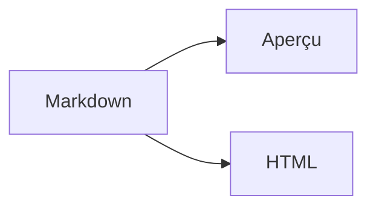
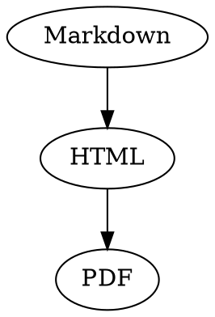

# WinDown

Bonjour ! Je suis **WinDown**, un éditeur Markdown pour Windows, inspiré de [MacDown](https://github.com/MacDownApp/macdown).

Laissez-moi me présenter.

## Markdown et moi

**Markdown** est une syntaxe de mise en forme de texte créée par John Gruber, pensée pour rester lisible telle quelle. La spécification d'origine se trouve [ici](http://daringfireball.net/projects/markdown/syntax).

**WinDown** est un éditeur simple pour les documents Markdown. Je génère votre texte en HTML en temps réel et je l'affiche dans le volet de prévisualisation.

Je comprends toute la syntaxe d'origine, mais je sais faire beaucoup plus. Les syntaxes populaires non standard s'activent ou se désactivent dans le volet [**Markdown**](#le-volet-markdown) des préférences (`Ctrl+,`).

- Le volet **Compilation** règle le rendu : feuille de style, coloration du code, formules, diagrammes.
- Le volet **Éditeur** règle la police, le thème de couleurs et les aides à la saisie.
- Le volet **Général** règle le comportement de l'application et la langue.
- Le volet **Terminal** installe la commande `windown`.

## Les bases

### Sauts de ligne

Pour forcer un saut de ligne, terminez la ligne par deux espaces puis Entrée.

* Cette puce sur deux lignes
ne sera pas coupée

* Cette puce sur deux lignes  
sera coupée

### Gras et emphase

**Gras** : `**Gras**` ou `__Gras__` (Ctrl+B)  
*Emphase* : `*Emphase*` ou `_Emphase_` (Ctrl+I)

### Titres

	Titre 1
	=======

	Titre 2
	-------

ou

	# Titre 1
	## Titre 2
	### Titre 3

### Liens et courriels

Un courriel entre chevrons devient cliquable : <nom@exemple.com>  
Même chose pour une adresse web : <https://github.com/MacDownApp/macdown>  
Avec un texte de lien : [Site du projet](https://github.com/MacDownApp/macdown "Titre")  

Style référence : voici [un lien][identifiant] défini ailleurs dans le fichier.

[identifiant]: https://github.com/MacDownApp/macdown "Titre"

### Images

``

Les chemins relatifs sont résolus à partir du dossier du document. Vous pouvez aussi glisser une image dans l'éditeur.

### Listes

* Une liste doit être précédée d'une ligne vide
* Les puces commencent par `*`
- `-` fonctionne aussi
	* Une tabulation de plus fait une liste imbriquée
		1. Les listes numérotées sont prises en charge.
		2. Chaque élément commence par un nombre, un point et une espace
		42. Peu importe le nombre : je numérote dans l'ordre

### Citations

> Le chevron `>` sert aux citations.
>
> > Les citations peuvent être imbriquées.
>
> * Listes
> * [Liens][identifiant]

### Code

`Code en ligne` s'écrit entre apostrophes inverses. Un bloc de code est indenté d'au moins quatre espaces :

	print('Ceci est un bloc de code')

### Ligne horizontale

Trois astérisques `***` ou trois tirets `---` seuls sur une ligne :

***

## Le volet Markdown

### Formatage de document

**Smartypants** transforme les guillemets droits (`"` et `'`) en guillemets typographiques selon le contexte.

### Formatage en bloc

Un tableau :

Premier en-tête | Deuxième en-tête
--------------- | ----------------
Cellule         | Cellule
Cellule         | Cellule

Alignement par des deux-points :

| Gauche      | Centré          | Droite |
|:----------- |:---------------:| ------:|
| col 3 est   | du texte long   |  1 600 |
| col 2 est   | centrée         |     12 |
| zèbre       | c'est joli      |      1 |

Un bloc de code avec langage (la coloration s'active dans le volet **Compilation**) :

```javascript
const salut = (nom) => `Bonjour ${nom} !`;
console.log(salut('monde'));
```

Avec la syntaxe ` ```python:main.py `, l'accessoire « Personnalisé » affiche `main.py` en haut du bloc.

### Formatage en ligne

Option             | Syntaxe          | Résultat
-------------------|------------------|-----------------------
Italique dans un mot | So A\*maz\*ing | So A<em>maz</em>ing
Barré              | \~~Bravo\~~      | <del>Bravo</del>
Souligné           | \_Bravo\_        | <u>Bravo</u>
Citation           | \"Bravo\"        | <q>Bravo</q>
Surligné           | \==Bravo\==      | <mark>Bravo</mark>
Exposant           | x\^(2)           | x<sup>2</sup>
Lien automatique   | http://t.co      | <http://t.co>
Notes              | [\^4]            | note [^4]

[^4]: Pas besoin d'un nombre : `[^ma note]` fonctionne aussi. Les notes sont numérotées dans l'ordre d'apparition dans le texte.

## Le volet Compilation

### Feuilles de style

Plusieurs feuilles CSS sont fournies ; vous pouvez en ajouter (bouton **Révéler**) ou choisir un fichier personnalisé.

### Formules mathématiques

Les formules s'affichent sans connexion internet. En ligne : \\( 1 + 1 \\) ; en bloc :

\\[
    A^T_S = B
\\]

### Listes de tâches

1. [x] Je sais afficher des cases à cocher
	* [x] Même imbriquées
2. [ ] Je ne sais pas cocher depuis l'aperçu

### Front-matter Jekyll

En tête de fichier, entre deux lignes `---` :

```
---
title: "WinDown est mon ami"
date: 2026-01-01 20:00:00
---
```

### Diagrammes

Avec **Mermaid** et **Graphviz** activés (et la coloration syntaxique) :





### Table des matières

Écrivez `[TOC]` seul sur une ligne pour générer la table des matières.

## Le volet Éditeur

Mon éditeur colore la syntaxe Markdown avec des thèmes inspirés de Mou. Vous pouvez en ajouter (bouton **Révéler**, extension `.style`).

Aides à la saisie : continuation des listes et des citations, numérotation automatique, caractères appariés, tabulations en espaces, début de ligne intelligent.

## Raccourcis

| Action | Raccourci |
|:--|:--|
| Gras, emphase, souligné | Ctrl+B, Ctrl+I, Ctrl+U |
| Titres 1 à 6, paragraphe | Ctrl+1 à Ctrl+6, Ctrl+0 |
| Code en ligne, lien, image | Ctrl+K, Ctrl+Maj+K, Ctrl+Maj+I |
| Liste numérotée, à puces, citation | Ctrl+Maj+O, Ctrl+Maj+U, Ctrl+Maj+B |
| Décaler | Ctrl+], Ctrl+[ |
| Générer l'aperçu | Ctrl+R |
| Masquer aperçu / éditeur | Ctrl+Maj+H, Ctrl+Maj+E |
| Copier le HTML | Ctrl+Maj+C |

Bonne écriture !

---

*WinDown est inspiré de MacDown (© Tzu-ping Chung, licence MIT).*
